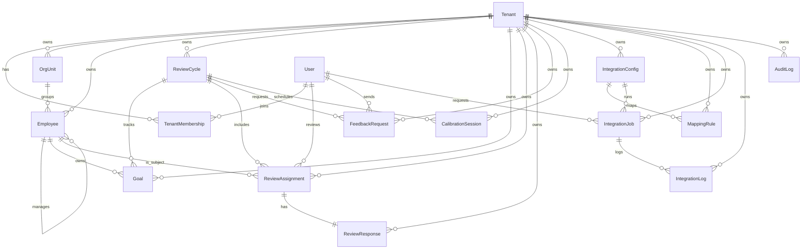

# Domain Model



**Correction to the diagram:** `ReviewAssignment ||--|| ReviewResponse` should read `ReviewAssignment ||--o| ReviewResponse`. The schema declares `response ReviewResponse?` (`prisma/schema.prisma:259`), so an assignment has zero or one response. Two of the three seeded assignments have no response (`prisma/seed.ts:297-325`), and `findSelfReviewContext` reads `assignment.response?.id ?? null` (`src/repositories/review-repository.ts:87`).

**Missing relations in the diagram (by reading the schema):** `User ||--o| Employee` via `Employee.userId @unique` (`schema.prisma:175,190`); `Employee ||--o{ TenantMembership` via `TenantMembership.employeeId` (`schema.prisma:144,147`); `OrgUnit ||--o{ OrgUnit` parent/children tree (`schema.prisma:160-163`); `User ||--o{ CalibrationSession` as facilitator (`schema.prisma:317`); `User ||--o{ AuditLog` as actor (`schema.prisma:406`); `Employee ||--o{ FeedbackRequest` as subject (`schema.prisma:300`); and `FeedbackRequest` has **two** user relations, `fromUser` and `toUser` (`schema.prisma:298-299`), not just "sends".

Entity ownership map:

- `Tenant`
  - Schema: `prisma/schema.prisma` model `Tenant`
  - Primary owner: `src/lib/auth/session.ts` because tenant selection is established before any service call
  - **Clarification:** `session.ts` owns the tenant *id*, taken from a header. No code reads the `Tenant` table (see "Runtime usage" below).
- `User`
  - Schema: `prisma/schema.prisma` model `User`
  - Primary owner: `src/lib/auth/session.ts` because demo auth resolves the active user there
  - **Clarification:** `session.ts` resolves users from the hard-coded `demoSessions` object (`src/lib/demo/demo-sessions.ts:22-55`), not from this table. The table is read only indirectly, as `requestedByUser.displayName` on integration jobs (`src/repositories/integration-repository.ts:45-47`).
- `TenantMembership`
  - Schema: `prisma/schema.prisma` model `TenantMembership`
  - Primary owner: `src/lib/auth/permissions.ts` because role enforcement depends on membership role
  - **Correction:** `permissions.ts` checks `session.tenantRole`, which comes from `demoSessions`, not from this table. Nothing in `src/` reads `TenantMembership` (by reading; finding A4 in auth-and-permissions.md). The table is written only by the seed (`prisma/seed.ts:198-241`).
- `OrgUnit`
  - Schema: `prisma/schema.prisma` model `OrgUnit`
  - Primary owner: `src/services/employee-service.ts` in `assertTenantReferences()`
- `Employee`
  - Schema: `prisma/schema.prisma` model `Employee`
  - Primary owner: `src/services/employee-service.ts`
- `ReviewCycle`
  - Schema: `prisma/schema.prisma` model `ReviewCycle`
  - Primary owner: `src/services/review-service.ts`
- `Goal`
  - Schema: `prisma/schema.prisma` model `Goal`
  - Primary owner: `src/repositories/review-repository.ts` in `listCycles()`
  - **Clarification:** only counted (`_count.goals`, `review-repository.ts:23-28`). No goal fields are ever read or written by the app.
- `ReviewAssignment`
  - Schema: `prisma/schema.prisma` model `ReviewAssignment`
  - Primary owner: `src/services/review-service.ts` in `submitSelfReview()`
- `ReviewResponse`
  - Schema: `prisma/schema.prisma` model `ReviewResponse`
  - Primary owner: `src/repositories/review-repository.ts` in `submitSelfReview()`
- `FeedbackRequest`
  - Schema: `prisma/schema.prisma` model `FeedbackRequest`
  - Primary owner: `src/repositories/review-repository.ts` via the cycle count query
- `CalibrationSession`
  - Schema: `prisma/schema.prisma` model `CalibrationSession`
  - Primary owner: `src/repositories/review-repository.ts` indirectly through the review bounded context
  - **Correction:** `review-repository.ts` does not touch calibration sessions at all; its `_count` selects only `goals`, `reviewAssignments` and `feedbackRequests` (lines 22-28). No code reads or writes this table, and the seed creates no rows (it only deletes them, `prisma/seed.ts:19`).
- `IntegrationConfig`
  - Schema: `prisma/schema.prisma` model `IntegrationConfig`
  - Primary owner: `src/services/integration-service.ts`
- `MappingRule`
  - Schema: `prisma/schema.prisma` model `MappingRule`
  - Primary owner: `src/repositories/integration-repository.ts`
  - **Correction:** `integration-repository.ts` never queries mapping rules. They exist only in the seed (`prisma/seed.ts:365-385`).
- `IntegrationJob`
  - Schema: `prisma/schema.prisma` model `IntegrationJob`
  - Primary owner: `src/services/integration-service.ts`
- `IntegrationLog`
  - Schema: `prisma/schema.prisma` model `IntegrationLog`
  - Primary owner: `src/repositories/integration-repository.ts` in `addLog()`
- `AuditLog`
  - Schema: `prisma/schema.prisma` model `AuditLog`
  - Primary owner: `src/repositories/audit-log-repository.ts`

---

## Runtime usage of each model

This table is built from every `db.<model>.<method>` and `tx.<model>.<method>` call in `src/` (21 calls, all in `src/repositories/`), plus `include`/`_count` relations (by reading).

| Model | Read by the app | Written by the app | Notes |
| --- | --- | --- | --- |
| Tenant | no | no | Tenant id is a header string (`session.ts:18-19`). |
| User | as `requestedByUser` on jobs | no | `integration-repository.ts:45-47` |
| TenantMembership | no | no | Seed only. |
| OrgUnit | `count` for reference checks; `include` on employees | no | `employee-repository.ts:90-98,50-52` |
| Employee | `findMany`, `findFirst`, `count` | `create`, `updateMany` | `employee-repository.ts` |
| ReviewCycle | `findMany` with `_count`; included in assignment lookup | no | `review-repository.ts:18-32,66-68` |
| Goal | `_count` only | no | |
| ReviewAssignment | `findFirst`; `_count` | conditional `updateMany` (status, submittedAt) | `review-repository.ts:57,106-121` |
| ReviewResponse | `id` via include | `create` (in the submit transaction) | `review-repository.ts:68-70,125-135` |
| FeedbackRequest | `_count` only | no | |
| CalibrationSession | no | no | Never seeded either. |
| IntegrationConfig | `findMany`, `findFirst`; included on jobs | no | `lastSuccessfulSyncAt` is never updated. |
| MappingRule | no | no | Seed only. |
| IntegrationJob | `findMany`, `findFirst` | `create`, `updateMany` (x3) | `integration-repository.ts` |
| IntegrationLog | newest 3 per job via include | `create` | `integration-repository.ts:48-52,244` |
| AuditLog | no | `create` | Write-only; there is no audit viewer. |

Of the sixteen models, four are never touched by the app (Tenant, TenantMembership, CalibrationSession, MappingRule), two are only counted (Goal, FeedbackRequest), and one is write-only (AuditLog). The schema describes more product than the code implements.

## Tenant scoping in the schema

Every model except `Tenant` and `User` has a `tenantId String` column and a `tenant` relation with `onDelete: Cascade` (`schema.prisma`, every model from line 139 on). That matches the header comment's rule (`schema.prisma:4-5`).

What the schema does **not** do (by reading):

- **Foreign keys are not tenant-composite.** For example `Employee.managerId` references `Employee.id` alone (`schema.prisma:191`). The database will happily store a manager from another tenant. Only the service check `assertTenantReferences()` (`src/services/employee-service.ts:107-128`) prevents it, and that is a read-then-write without a transaction.
- **No self-reference guard.** `managerId` can equal the employee's own `id`. The service only checks the manager exists in the tenant. Scratch test G3 (run) sets `emp_sam`'s manager to `emp_sam` and it succeeds. Longer cycles (A manages B manages A) are equally possible.
- **`workEmail` is not unique**, while `employeeNumber` is unique per tenant (`schema.prisma:201`). Two employees in a tenant can share a work email.
- `ReviewResponse` has two unique constraints that say the same thing: `reviewAssignmentId @unique` (line 271) and `@@unique([tenantId, reviewAssignmentId])` (line 282). The repository used to `upsert` on the composite one. It now calls `create` (`review-repository.ts:125-135`), so a second response for the same assignment fails on either unique key, after the conditional `updateMany` has already refused it.
- There is no uniqueness on `ReviewAssignment` for `(reviewCycleId, subjectEmployeeId, reviewerUserId, type)`. Two SELF assignments for the same person in the same cycle are allowed; `findFirst` would then pick one arbitrarily (`review-repository.ts:57`).

## Status enums: declared vs reachable

`src/lib/domain.ts` mirrors every Prisma enum as a `const` tuple. The tuples and the Prisma enums match value for value (by reading `domain.ts:7-75` against `schema.prisma:15-98`). Three enums exist only in Prisma, not in `domain.ts`: `ReviewAssignmentType`, `GoalStatus` and `FeedbackRequestStatus`.

### IntegrationJob status (`schema.prisma:83-90`)

| Value | Who writes it | Evidence |
| --- | --- | --- |
| QUEUED | `createJob` (new job); `queueRetry` (retry) | `integration-repository.ts:73,123` |
| RUNNING | `claimQueuedJobs` | `integration-repository.ts:191` |
| SUCCEEDED | `completeJob` when `success` | `integration-repository.ts:225` |
| FAILED | `completeJob` when not `success` | `integration-repository.ts:225` |
| RETRY_REQUIRED | **nobody** (only accepted as a retry source) | `integration-service.ts:88` |
| CANCELLED | **nobody** | |

Transitions the code implements:

```
            createJob                 claimQueuedJobs              completeJob
(new) ─────────────────> QUEUED ─────────────────────> RUNNING ───────────────────> SUCCEEDED
                           ^                                    └──────────────────> FAILED
                           │               retryJob (status FAILED or RETRY_REQUIRED)  │
                           └───────────────────────────────────────────────────────────┘
```

Facts about the transitions (all run in the scratch harness):

- `attemptCount` starts at 0 (`schema.prisma:367`) and is now incremented **only** when a worker claims the job (`integration-repository.ts:195`), so it counts runs. `queueRetry` no longer touches it. In the earlier code it was the reverse: only `queueRetry` incremented it and processing did not count (test J4, run against that code). The seeded failed job shows `attemptCount: 2` (`prisma/seed.ts:401`), a value written directly by the seed, so it does not tell you which rule produced it.
- `claimToken` (`schema.prisma:368`, indexed with `tenantId` at `:379`) is set on claim, required by `completeJob`, and cleared by `queueRetry`. Nothing clears it after completion, so a finished job keeps its last token.
- There is no upper bound on retries (test J7: 25 retries, `attemptCount` 25).
- Neither `queueRetry`, the claim update, nor `completeJob` checks the current status in its `where` clause. Every transition is "whatever the service saw a moment ago". See the race findings in request-lifecycle.md and flow-traces.md.
- A job left in RUNNING (because the sweep crashed) has no way out: the sweep only looks at QUEUED, and retry only accepts FAILED/RETRY_REQUIRED (test J9).

### ReviewAssignment status (`schema.prisma:49-54`)

| Value | Who writes it | Evidence |
| --- | --- | --- |
| NOT_STARTED | default; seed | `schema.prisma:252` |
| IN_PROGRESS | seed only | `prisma/seed.ts:303` |
| SUBMITTED | `submitSelfReview` | `review-repository.ts:118` |
| APPROVED | **nobody** | |

The service blocks re-submission only when the status is exactly `SUBMITTED` (`review-service.ts:68`). An `APPROVED` assignment would be moved back to `SUBMITTED` and its response overwritten (test R1, run). Since nothing writes `APPROVED` today, this is latent, but it is exactly the kind of guard that breaks when a manager-approval feature is added. Fix sketch: allow submission only from `NOT_STARTED` or `IN_PROGRESS`.

### ReviewCycle status (`schema.prisma:36-41`)

Never written by the app. Submission requires `ACTIVE` (`review-service.ts:60-65`; test R2 covers DRAFT, CALIBRATING and COMPLETED). The cycle's `startDate`/`endDate` are **not** checked: the seeded ACTIVE cycle ended on 2026-05-15 (`prisma/seed.ts:252`) and still accepts submissions as long as its status says ACTIVE (by reading).

### EmploymentStatus (`schema.prisma:29-34`)

Any value can be set on create or update (`employeeSchemas.ts:18,30`). There is no transition rule (a TERMINATED employee can be set back to ONBOARDING) and `endDate` (`schema.prisma:188`) is never set by the app.

### AuditAction (`schema.prisma:92-98`)

| Value | Emitted by |
| --- | --- |
| EMPLOYEE_CREATED | `employee-service.ts:67` |
| EMPLOYEE_UPDATED | `employee-service.ts:96` (metadata lists the field **names** only, not old/new values, line 100) |
| REVIEW_SUBMITTED | `review-repository.ts:137-149` (inside the submit transaction) |
| INTEGRATION_JOB_RETRIED | `integration-repository.ts:141-150` (inside the retry transaction) |
| INTEGRATION_JOB_PROCESSED | **never** (test J12, run) |

## Seed data at a glance

| Kind | Rows | Source |
| --- | --- | --- |
| Tenants | `tenant_northstar` (Northstar Health), `tenant_atlas` (Atlas Manufacturing) | `prisma/seed.ts:31-44` |
| Users | 5 northstar users matching the demo sessions, plus `user_atlas_hr` | `prisma/seed.ts:46-85` |
| Org units | `org_people`, `org_platform` (northstar), `org_atlas_people` | `prisma/seed.ts:86-108` |
| Employees | `emp_alex` (HR Director), `emp_morgan` (reports to Alex), `emp_sam` (reports to Morgan), `emp_ivy` (reports to Alex), `emp_atlas_hr` | `prisma/seed.ts:110-195` |
| Review cycles | `cycle_2026_h1` ACTIVE (2026-03-01 to 2026-05-15), `cycle_2026_calibration_prep` DRAFT | `prisma/seed.ts:244-265` |
| Assignments | Sam SELF in h1 (IN_PROGRESS), Morgan reviewing Sam (MANAGER, NOT_STARTED), Sam SELF in the draft cycle (NOT_STARTED) | `prisma/seed.ts:294-327` |
| Goals | 2 in h1 (Sam, Morgan) | `prisma/seed.ts:267-292` |
| Feedback | 1 PENDING request about Sam | `prisma/seed.ts:329-341` |
| Integration configs | `config_workday_export`, `config_greenhouse_import`, both active | `prisma/seed.ts:342-363` |
| Jobs | `job_failed_workday` FAILED with `simulateFailure: true`, `attemptCount: 2`; `job_queued_greenhouse` QUEUED | `prisma/seed.ts:387-418` |

Useful consequences for manual testing:

- As `user_employee`, submitting to `cycle_2026_h1` succeeds once; a second submit gets 409 "already been submitted". Submitting to `cycle_2026_calibration_prep` gets 409 "only allowed while the cycle is ACTIVE".
- As `user_hr_admin` or `user_manager`, submitting gets 404, because neither has a SELF assignment.
- Retrying `job_failed_workday` and then processing will fail again every time: its payload still carries `simulateFailure: true` (`prisma/seed.ts:397`), and retry does not change the payload.
- The Atlas tenant is reachable only as the platform admin with `x-demo-tenant-id: tenant_atlas`.

## Exercises

1. Which models could you delete from the schema without changing any API response? Answer: `CalibrationSession` and `MappingRule` (never touched), and `TenantMembership` (never read). `Goal` and `FeedbackRequest` would change the `counts` object in `GET /api/review-cycles`.
2. Why does setting `RETRY_REQUIRED` by hand in the database make a job retryable, but setting `CANCELLED` does not? Answer: `retryJob` allows exactly `["FAILED", "RETRY_REQUIRED"]` (`integration-service.ts:88`).
3. What would it take for the database itself to reject a cross-tenant manager? Answer: a composite unique `@@unique([tenantId, id])` on `Employee` and a composite relation `fields: [tenantId, managerId], references: [tenantId, id]`.
