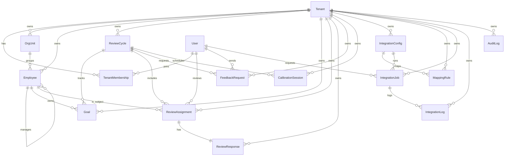

# Domain Model

Entity ownership map:

- `Tenant`
  - Schema: `prisma/schema.prisma` model `Tenant`
  - Primary owner: `src/lib/auth/session.ts` because tenant selection is established before any service call
- `User`
  - Schema: `prisma/schema.prisma` model `User`
  - Primary owner: `src/lib/auth/session.ts` because demo auth resolves the active user there
- `TenantMembership`
  - Schema: `prisma/schema.prisma` model `TenantMembership`
  - Primary owner: `src/lib/auth/permissions.ts` because role enforcement depends on membership role
- `OrgUnit`
  - Schema: `prisma/schema.prisma` model `OrgUnit`
  - Primary owner: `src/services/employee-service.ts` in `assertTenantReferences()`
- `Employee`
  - Schema: `prisma/schema.prisma` model `Employee`
  - Primary owner: `src/services/employee-service.ts`
- `ReviewCycle`
  - Schema: `prisma/schema.prisma` model `ReviewCycle`
  - Primary owner: `src/services/review-service.ts`
- `Goal`
  - Schema: `prisma/schema.prisma` model `Goal`
  - Primary owner: `src/repositories/review-repository.ts` in `listCycles()`
- `ReviewAssignment`
  - Schema: `prisma/schema.prisma` model `ReviewAssignment`
  - Primary owner: `src/services/review-service.ts` in `submitSelfReview()`
- `ReviewResponse`
  - Schema: `prisma/schema.prisma` model `ReviewResponse`
  - Primary owner: `src/repositories/review-repository.ts` in `submitSelfReview()`
- `FeedbackRequest`
  - Schema: `prisma/schema.prisma` model `FeedbackRequest`
  - Primary owner: `src/repositories/review-repository.ts` via the cycle count query
- `CalibrationSession`
  - Schema: `prisma/schema.prisma` model `CalibrationSession`
  - Primary owner: `src/repositories/review-repository.ts` indirectly through the review bounded context
- `IntegrationConfig`
  - Schema: `prisma/schema.prisma` model `IntegrationConfig`
  - Primary owner: `src/services/integration-service.ts`
- `MappingRule`
  - Schema: `prisma/schema.prisma` model `MappingRule`
  - Primary owner: `src/repositories/integration-repository.ts`
- `IntegrationJob`
  - Schema: `prisma/schema.prisma` model `IntegrationJob`
  - Primary owner: `src/services/integration-service.ts`
- `IntegrationLog`
  - Schema: `prisma/schema.prisma` model `IntegrationLog`
  - Primary owner: `src/repositories/integration-repository.ts` in `addLog()`
- `AuditLog`
  - Schema: `prisma/schema.prisma` model `AuditLog`
  - Primary owner: `src/repositories/audit-log-repository.ts`
